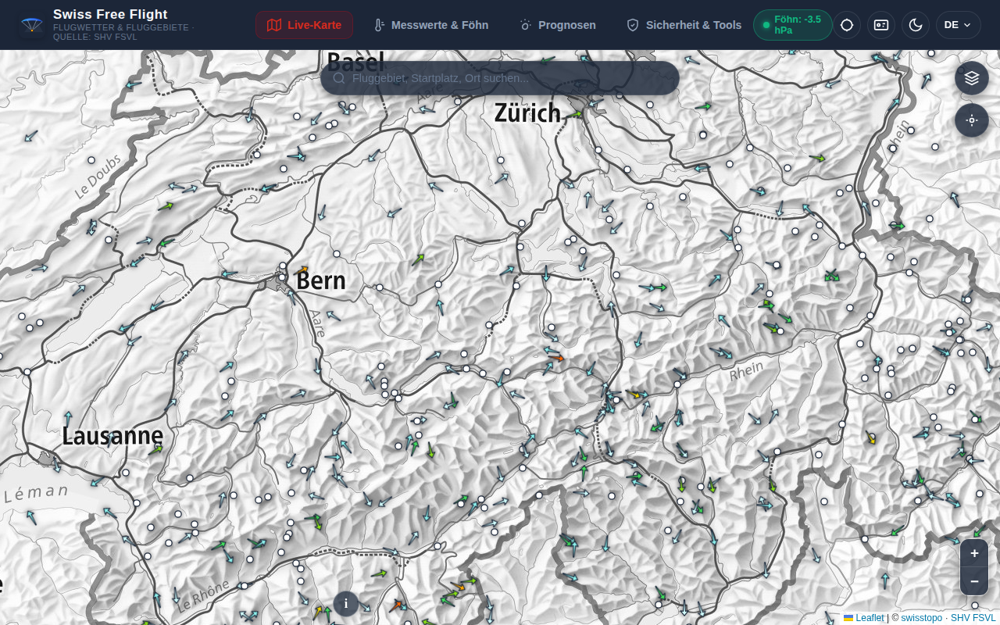
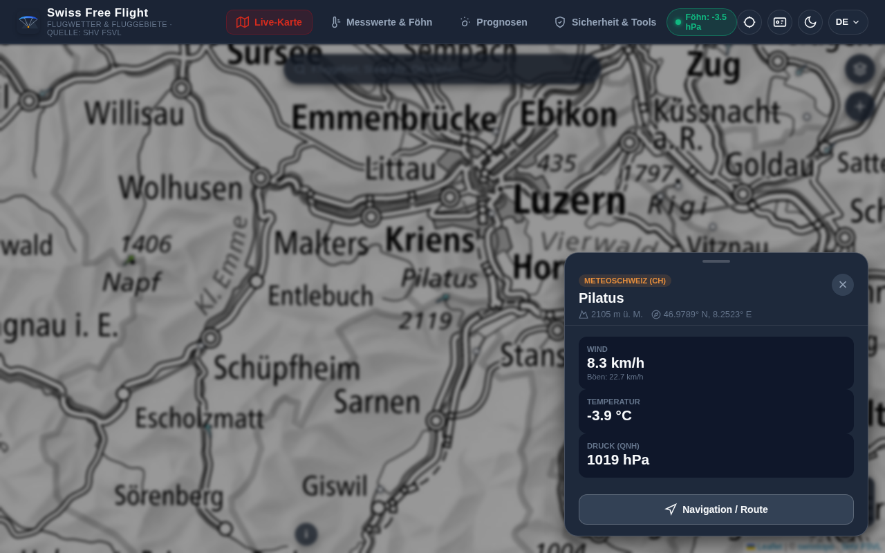
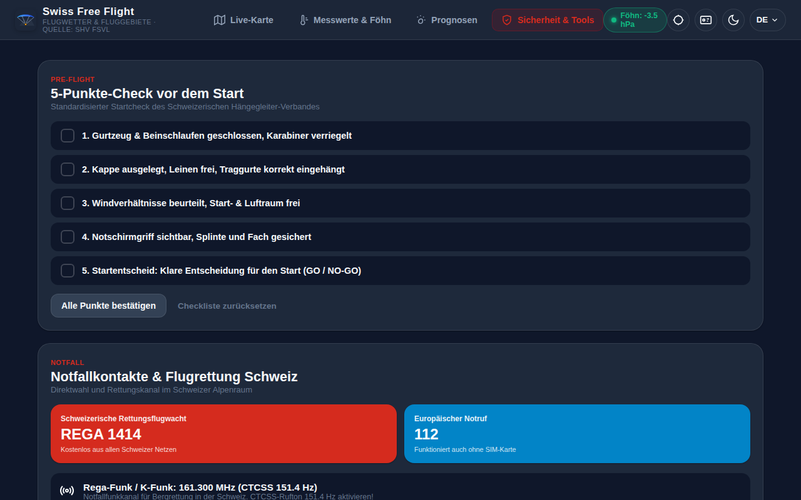
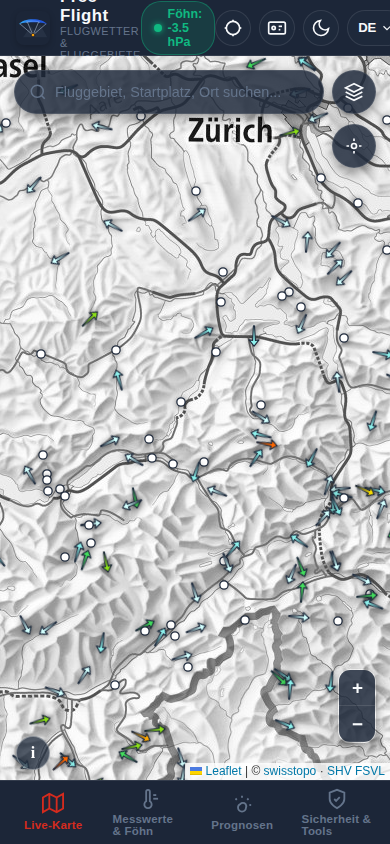

# Swiss Free Flight Web Application

> **⚠️ DISCLAIMER: This whole repository was entirely generated by LLMs, with human guidance but WITHOUT ANY human review. Use at your own risk.**

Interactive flight preparation, meteorological observation, and airspace safety platform for paraglider and hang glider pilots in Switzerland.

> **Data Sources**: Flying sites, take-offs, landings, and landing circuits sourced from the **Swiss Hang Gliding and Paragliding Association (SHV FSVL)**. Meteorological observations, forecasts, and geographical data provided by MeteoSwiss, Swisstopo, and BAZL.

---

## Features

* **Interactive Flying Sites Map**:
  * **Startplätze (Take-offs)**: High-visibility markers with cardinal heading badges (`SW`, `NNE`) and directional pointers showing launch orientation.
  * **Landeplätze (Landings)**: Disks with elevation, difficulty, and landing instructions.
  * **Landevolten (Landing Circuits)**: Dual-stroke trajectory circuits with approach arrowheads and circuit popups.
  * **Aviation Obstacles (Hindernisse)**: Power lines, cable cars, transmission cables, and antennas across Switzerland.
  * **Airspaces (Lufträume)**: Swiss CTR, TMA, and restricted airspace zones.
  * **Basemaps**: Swisstopo National Map (Light & Color), Swisstopo Satellite (SWISSIMAGE orthophoto), and OpenStreetMap.

* **Real-Time Weather & Observations**:
  * **Live Wind Stations**: Wind direction arrows, wind speed, gust surges, and temperature across Switzerland and neighboring alpine border regions (France, Italy, Austria, Germany).
  * **Alpine Föhn & Druckdifferenz**: Live barometric pressure gradients across the Alpine ridge (Gotthard, San Bernardino, Simplon, Jura) and 24-hour Gotthard pressure difference history charts.
  * **Messwerte Table**: Searchable and Canton-filterable weather observation stations.
  * **Live Webcams Gallery**: Real-time webcam feeds from Swiss flying sites and mountain passes.

* **Forecasts & Meteorological Analysis (Prognosen)**:
  * **Alpenwetter Textprognosen**: Daily soaring weather forecast bulletins, thermals rating, and regional flight outlooks.
  * **Aussichten Map Forecast Overlay**: Multi-day spatial forecast map with interactive time slider.
  * **Interactive Emagramm Soundings**: Atmospheric temperature and dew point profiles, dry/moist adiabatic lapse rate calculations, and thermal ceiling estimates.
  * **Isobaren Charts**: Synoptic surface pressure analysis and isobar charts.

* **Safety & Flight Operations (Sicherheit & Flugpraxis)**:
  * **DABS (Daily Airspace Bulletin Switzerland)**: Current aviation safety warnings and temporary flight restrictions.
  * **Pre-Flight Checklist**: 5-point take-off safety check.
  * **Pilot Flight Logbook (Flugbuch)**: Log flights, track total airtime, and review flight statistics.
  * **Variometer Audio Simulator**: Interactive climb/sink audio variometer simulator.

---

## Visual Gallery & Screenshots

Taken with `npm run shot` on the built site at 1280×800 (the weather page taller, the last one at phone width), with live data from 2026-11-24. The emagram is missing while upstream's ICON soundings are down; it comes back once they answer again.

### 1. Live Map

| Live Wind Stations | Take-off Detail (`/map/?site=`) |
| :---: | :---: |
| [](screenshots/01_map_wind_stations.png) | [](screenshots/02_map_take-off_sheet.png) |
| **Weather Station Detail (`/map/?station=`)** | **Webcam Detail (`/map/?webcam=`)** |
| [](screenshots/03_map_station_sheet.png) | [](screenshots/04_map_webcam_sheet.png) |

### 2. Live Weather & Föhn

| Station Pairs, 24h Pressure Difference and Webcams |
| :---: |
| [](screenshots/05_weather_foehn_webcams.png) |

### 3. Forecasts

| Text Forecasts | Outlooks (`/forecast/outlooks/?type=`) |
| :---: | :---: |
| [](screenshots/06_forecast_text.png) | [](screenshots/07_forecast_outlooks.png) |
| **Isobar Chart** | **Safety: Checklist, Emergency, DABS, Vario, Logbook** |
| [](screenshots/08_forecast_isobars.png) | [](screenshots/09_safety.png) |

### 4. Phone

| Map with the Bottom Navigation |
| :---: |
| [](screenshots/10_mobile_map.png) |

---

## Quick Start

Needs Node.js 24 and Python 3 (for the git hooks).

```bash
npm install
npm run dev   # Astro on http://localhost:4321/map/, Pages Functions on port 8788
```

The site is built with Astro and deployed to Cloudflare Pages at <https://shv-meteo.pages.dev>, with its API as Pages Functions.

---

## Documentation

* [docs/setup.md](docs/setup.md): local setup, scripts, screenshots tool, troubleshooting.
* [docs/deployment.md](docs/deployment.md): deploying to Cloudflare Pages.
* [docs/architecture.md](docs/architecture.md): data sources, which calls are proxied and why, how the code is organised.
* [docs/reference/shv-native-app.md](docs/reference/shv-native-app.md): reverse-engineered notes on the official SHV FSVL app and its backends.
* [GLOSSARY.md](GLOSSARY.md): domain terms (German and English).
* [AGENTS.md](AGENTS.md): rules for changing the code, for AI agents and humans.

---

## License

Apache-2.0 / SHV FSVL
