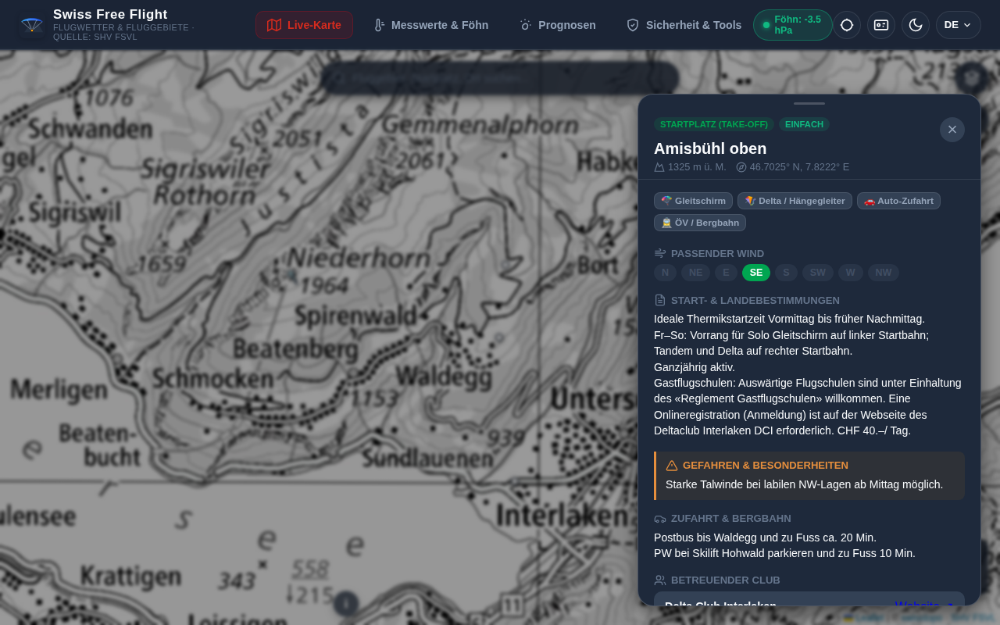
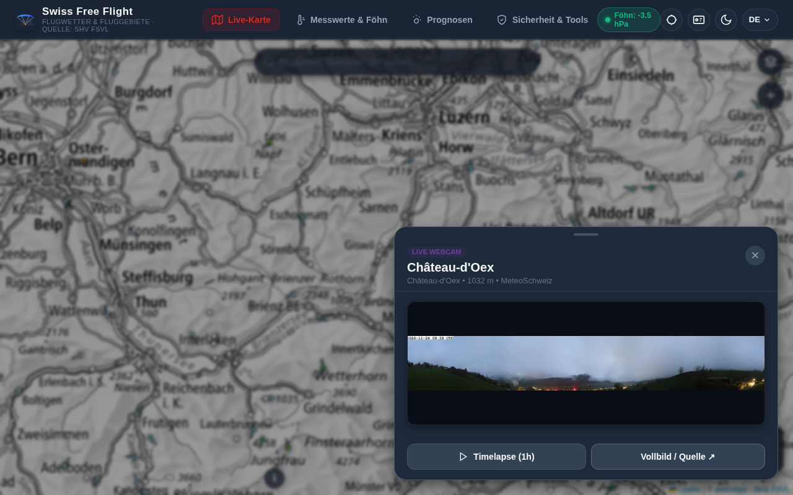
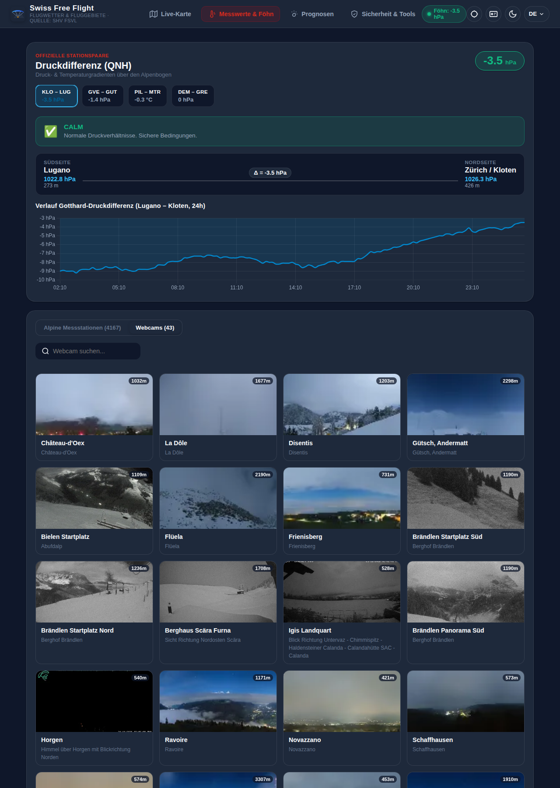
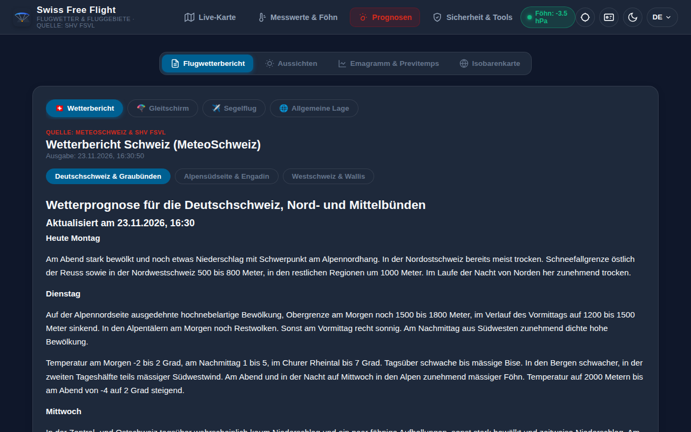
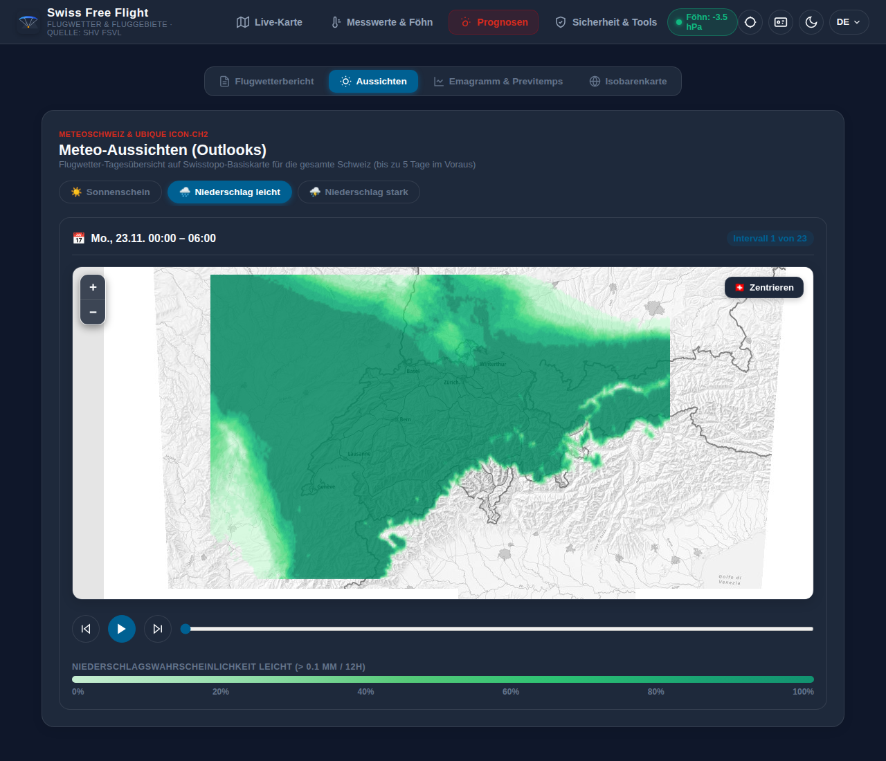
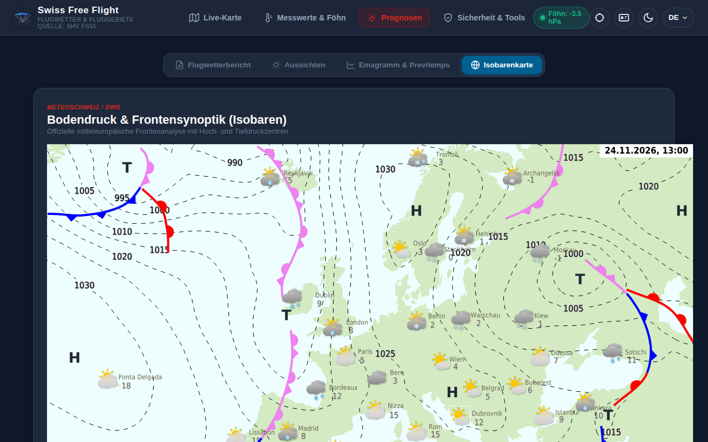

# Swiss Free Flight

> **⚠️ DISCLAIMER: This whole repository was entirely generated by LLMs, with human guidance but WITHOUT ANY human review. Use at your own risk.**

Flight preparation for paraglider and hang glider pilots in Switzerland: flying sites, airspace and obstacles, live wind and föhn, and soaring forecasts, from the public data behind the official SHV FSVL app. Live at <https://shv-meteo.pages.dev>, in German, French, Italian and English.

It is a static [Astro](https://astro.build) site on Cloudflare Pages. The browser loads the flying sites and other GIS data as static files, and the weather, webcams and soundings through Pages Functions under `/api/*`, which proxy and edge-cache the upstreams a browser can't call directly. There is no login and no member data. Forked from [unbe/ai-shv-app](https://github.com/unbe/ai-shv-app).

> **Data sources**: flying sites, take-offs, landings and landing circuits from the **Swiss Hang Gliding Association (SHV FSVL)**; weather, forecasts and soundings from MeteoSwiss and the other station networks; base maps from swisstopo and OpenStreetMap; obstacles and the glider chart from BAZL (FOCA); airspace and DABS from skyguide.

---

## What it does

* **Map** (`/map/`):
  * Take-offs with their orientation, landings and landing circuits; a search, and a wind-direction filter that keeps the take-offs suited to the wind.
  * Airspace (CTR, TMA, gliding areas), BAZL aviation obstacles (power lines, cable cars, antennas), wildlife rest areas and reserves.
  * One live weather layer at a time: wind and gusts, temperature, the föhn station pairs, or webcams.
  * Base maps: swisstopo light and national map, SWISSIMAGE aerial images, OpenStreetMap, BAZL's glider chart.
  * A take-off, station, webcam or obstacle opens its sheet; `/map/?site=`, `?station=` and `?webcam=` link straight to one.
* **Weather** (`/weather/`):
  * The official app's four station pairs (Kloten to Lugano, Geneva to Güttingen, Pilatus to Matro, Delémont to Grenchen) with their 24-hour history.
  * Every station, searchable and filtered by network (MeteoSwiss, Météo-France, GeoSphere Austria, DWD, SLF, Holfuy and more), each with a 24-hour chart of wind, temperature and dew point.
  * The webcams.
* **Forecast** (`/forecast/`):
  * Text forecasts: the regional weather report, the paragliding and gliding forecasts, the general situation.
  * Outlooks: sunshine and precipitation probability, animated over the coming days.
  * The surface pressure (isobar) chart.
  * Soundings from MeteoSwiss ICON-CH1 as an emagram, the temperature coloured by lapse rate.
* **Safety** (`/safety/`): the SHV 5-point pre-flight check, emergency numbers (Rega 1414, 112, radio channel K) and the tree-landing steps, links to the day's DABS on skybriefing, an audio vario simulator, and a logbook kept in your browser with a CSV export.

---

## Screenshots

Taken with `npm run shot` on the built site at 1280×800 (the weather page taller, the last one at phone width), with live data from 2026-11-24. The emagram is missing while upstream's ICON soundings are down; it comes back once they answer again.

### 1. Live Map

| Live Wind Stations | Take-off Detail (`/map/?site=`) |
| :---: | :---: |
| [](screenshots/01_map_wind_stations.png) | [](screenshots/02_map_take-off_sheet.png) |
| **Weather Station Detail (`/map/?station=`)** | **Webcam Detail (`/map/?webcam=`)** |
| [](screenshots/03_map_station_sheet.png) | [](screenshots/04_map_webcam_sheet.png) |

### 2. Live Weather & Föhn

| Station Pairs, 24h Pressure Difference and Webcams |
| :---: |
| [](screenshots/05_weather_foehn_webcams.png) |

### 3. Forecasts

| Text Forecasts | Outlooks (`/forecast/outlooks/?type=`) |
| :---: | :---: |
| [](screenshots/06_forecast_text.png) | [](screenshots/07_forecast_outlooks.png) |
| **Isobar Chart** | **Safety: Checklist, Emergency, DABS, Vario, Logbook** |
| [](screenshots/08_forecast_isobars.png) | [](screenshots/09_safety.png) |

### 4. Phone

| Map with the Bottom Navigation |
| :---: |
| [](screenshots/10_mobile_map.png) |

---

## Quick Start

Needs Node.js 24 and Python 3 (for the git hooks).

```bash
npm install
npm run dev   # open http://localhost:4321/map/ (Astro; the Pages Functions run on 8788)
```

Without `npm run obstacles` (a 128 MB download) the obstacle layer stays empty locally. The other scripts are in [docs/setup.md](docs/setup.md).

---

## Documentation

* [docs/setup.md](docs/setup.md): local setup, scripts, screenshots tool, troubleshooting.
* [docs/deployment.md](docs/deployment.md): deploying to Cloudflare Pages, rollback, secrets.
* [docs/architecture.md](docs/architecture.md): data sources, which calls are proxied and why, every `/api` route, how the code is organised.
* [docs/research/](docs/research/): dated notes with the measurements behind a decision.
* [docs/plan/2026-11-24-follow-ups/](docs/plan/2026-11-24-follow-ups/README.md): what is shipped and what is left.
* [docs/reference/shv-native-app.md](docs/reference/shv-native-app.md): reverse-engineered notes on the official SHV FSVL app and its backends.
* [docs/reference/shv-native-auth.md](docs/reference/shv-native-auth.md): how the official app logs members in and reads their profile.
* [docs/reference/shv-app-emulator.md](docs/reference/shv-app-emulator.md): running the official app on an Android emulator to compare with it.
* [docs/reference/shv-app-traffic-capture.md](docs/reference/shv-app-traffic-capture.md): capturing its HTTPS calls with mitmproxy.
* [GLOSSARY.md](GLOSSARY.md): domain terms (German and English).
* [AGENTS.md](AGENTS.md): rules for changing the code, for AI agents and humans.
