# C1 · Each route owns its parameter rules

[← Report](README.md)

🟢 **Strong** · `in-process` · ↔ `two-way` · builds on: none

`src/scripts/upstream/routes.ts:6-21,61-120` · `src/scripts/upstream/params.ts:33-69` · `src/scripts/upstream/respond.ts:194-242` · `src/scripts/emagram/fetch.ts:100-121`

```mermaid
flowchart LR
  subgraph before["Before"]
    direction TB
    F1["functions/api/*"]:::module --> S1["serve(name, ctx, fetcher, check)"]:::shallow
    S1 --> P1["parseParams · if route === …"]:::leak
    S1 --> R1["ROUTES[name] · url, ttl, query"]:::shallow
    S1 -- "check hook" --> C1n["soundingRoute · unknownStation"]:::leak
    P1 -- "same RouteName, no tie" --> R1
  end
  subgraph after["After"]
    direction TB
    F2["functions/api/*"]:::module --> S2["serve(name, ctx, fetcher)"]:::module
    S2 --> R2["ROUTES[name] · parse(path, search)"]:::deep
    subgraph deepmod[" "]
      direction TB
      Q2["query keys"]:::faded
      V2["path checks · 400 / 404"]:::faded
      U2["upstream url"]:::faded
    end
    R2 -.- deepmod
  end
  before ~~~ after
  classDef module fill:#ffffff,stroke:#64748b,stroke-width:2px,color:#0f172a
  classDef shallow fill:#f1f5f9,stroke:#94a3b8,stroke-dasharray:4 3,color:#334155
  classDef deep fill:#0f172a,stroke:#0f172a,color:#e2e8f0
  classDef faded fill:#1e293b,stroke:#475569,color:#94a3b8
  classDef leak fill:#fef2f2,stroke:#dc2626,stroke-width:2px,color:#991b1b
  style deepmod fill:#0f172a,stroke:#0f172a
  style before fill:#fafaf9,stroke:#e2e8f0
  style after fill:#fafaf9,stroke:#e2e8f0
```

`respond.ts` and `routes.ts` change together in 6 commits (75%); a route's rules sit in two files keyed by one string union, and a new route compiles with no parsing branch.

**Removes:**

- `src/scripts/upstream/params.ts:42-68`: the `if (route === "timeseries" | "textForecast" | "sounding" | "foehn")` chain.
- `src/scripts/upstream/routes.ts:19`: `query: string[]`, set to `query: []` on the five routes that take none.
- `src/scripts/upstream/respond.ts:198-214`: `serve`'s `check` option, used by one route.
- `src/scripts/emagram/fetch.ts:120`: the `check` closure that answers the sounding's 404.

| Problem | Solution | Wins |
|---|---|---|
| A route's checks live in a switch in another module, tied to the route table only by a string, and the 404 for an unknown station comes in through a separate hook. | Each `ROUTES` entry carries the parsing of its own path and query, 400 and 404 included, and `params.ts` keeps only the shared helpers. | locality: a route reads in one place interface: `serve` loses `check` new route without rules won't compile |

Decisions

<!-- filled during implementation, one line each -->

- Q1: what shape does the deepened module take? → `Route` loses `query` and gains a required `parse(path, search): Record<string, string> | Response`; each `ROUTES` entry carries its own parse, `parseParams` and its `if (route === ...)` chain go, and `params.ts` keeps only the shared helpers (`badRequest`, `decoded`, a `none` parse for the routes that take nothing), because the chain has 4 branches keyed by a string union that compile without one, while a required field makes a new route without rules a type error.
- Q2: typed parameters per route, or `Record<string, string>`? → `Record<string, string>`, because `serve` builds the cache key from `Object.entries(params)` and every route's parameters are strings today (id, lang, name, pair); a generic `Route
` would be erased by `Record<RouteName, Route>` anyway.
- Q3: which dependency category? → in-process (DEEPENING category 1): parsing is pure, so the route tables are tested through `ROUTES.<name>.parse` directly, no adapter; `params.test.ts` survives with its calls rewritten from `parseParams("timeseries", ...)` to `ROUTES.timeseries.parse(...)`, because none of its cases needs anything but the path and search.
- Q4: can the grid-dependent 404 live in the sounding route's parse? → yes: `emagram/grid.ts` imports the grid with `with { type: "json" }` and `ROUTES.sounding.parse` answers the 404 "Unbekannte Sondierungsstation" itself, so `serve` loses `check` and `soundingRoute` loses its `grid` parameter, because the JSON sat in `functions/` only by choice (plan `prs-api.md:35`, "only the Function imports the JSON"), not for bundling: Node 24 refuses the plain import (`ERR_IMPORT_ATTRIBUTE_MISSING`, reproduced), while with the attribute `wrangler pages functions build` compiles and `astro check` reports 0 errors (both run on this branch, then reverted), and Pages builds every Function into one Worker, so the 24 KB grid was already in it.
- Q5: what do the sounding tests run against once the grid is imported? → the real grid: `fetch.test.ts` drops its fixture grid and reads the expected point from `GRID["disentis/mustér"]` (pointIndex 786116 today, not 42), and `grid.test.ts` keeps its fixture since `gridPoint(name, grid)` keeps its parameter, because the tests' only station, Disentis/Mustér, is in the 107-station grid and "Atlantis" is not, so the 404 test holds unchanged.
- Q6: does `routes.ts` importing the grid create a cycle or a bootstrap problem? → move `USER_AGENT` from `routes.ts` to `upstream/fetch.ts`, its sender, because `scripts/previtemps-grid.ts:11` (the script that writes the grid) and `scripts/obstacles.ts:25` import `USER_AGENT` from `routes.ts`, which would make the grid script load the file it is about to rewrite; `upstream/fetch.ts` then no longer imports `routes.ts`.
- Q7: does the Function file stay a route helper? → yes, `soundingRoute(ctx, fetchFn = fetch)` stays in `emagram/fetch.ts` as the seam the tests inject `fetchFn` through, and `functions/api/meteo/previtemps/forecast/[name].ts` becomes `soundingRoute(ctx)` with no grid import; AGENTS.md's Functions rule drops "which takes the generated grid", because 7 of `fetch.test.ts`'s cases call `soundingRoute` end to end with a fake fetch.
- Q8 (S1): which station id pattern wins, and where does it live? → `/^[a-z_]+:[^/\s]{1,100}$/`, exported as `STATION_ID` from `src/scripts/handoff.ts` (no imports, safe for browser and Functions) and imported by `params.ts`; the handoff uses it for `?station` and `?webcam` both, because all 2,253 live measurement ids (12 providers) and all 40 webcam ids (4 providers) matched it on 2026-11-25, so the looser `[\w-]{1,50}` only lets through ids the Function then refuses with a 400.
- Q9 (S2): how does a compute get its timeout? → `serve` calls `compute(params, route.timeoutMs)` and `proxy` passes the same; `foehnResponse(pair, timeoutMs)` and `fetchForecast(point, timeoutMs, fetchFn)` take it as a parameter, their `TIMEOUT_MS = ROUTES.x.timeoutMs` constants go, and the call-count comments at `routes.ts:107-114` move into the headers of `foehn/fetch.ts` and `emagram/fetch.ts` (the latter already says it), because `foehn/fetch.ts:34` and `emagram/fetch.ts:28` are each module's only read of its own route entry, and after Q4 `emagram/fetch.ts` needs nothing else from `routes.ts`.
- Q10: one-way door? → no: no wire format, cache key or stored data changes (the parsed parameters, hence the `/api/_cache/<name>?...` keys, stay the same for every route), so a revert undoes it; the row stays `in-progress`.

