# C1 · Each route owns its parameter rules

[← Report](README.md)

🟢 **Strong** · `in-process` · ↔ `two-way` · builds on: none

`src/scripts/upstream/routes.ts:6-21,61-120` · `src/scripts/upstream/params.ts:33-69` · `src/scripts/upstream/respond.ts:194-242` · `src/scripts/emagram/fetch.ts:100-121`

```mermaid
flowchart LR
  subgraph before["Before"]
    direction TB
    F1["functions/api/*"]:::module --> S1["serve(name, ctx, fetcher, check)"]:::shallow
    S1 --> P1["parseParams · if route === …"]:::leak
    S1 --> R1["ROUTES[name] · url, ttl, query"]:::shallow
    S1 -- "check hook" --> C1n["soundingRoute · unknownStation"]:::leak
    P1 -- "same RouteName, no tie" --> R1
  end
  subgraph after["After"]
    direction TB
    F2["functions/api/*"]:::module --> S2["serve(name, ctx, fetcher)"]:::module
    S2 --> R2["ROUTES[name] · parse(path, search)"]:::deep
    subgraph deepmod[" "]
      direction TB
      Q2["query keys"]:::faded
      V2["path checks · 400 / 404"]:::faded
      U2["upstream url"]:::faded
    end
    R2 -.- deepmod
  end
  before ~~~ after
  classDef module fill:#ffffff,stroke:#64748b,stroke-width:2px,color:#0f172a
  classDef shallow fill:#f1f5f9,stroke:#94a3b8,stroke-dasharray:4 3,color:#334155
  classDef deep fill:#0f172a,stroke:#0f172a,color:#e2e8f0
  classDef faded fill:#1e293b,stroke:#475569,color:#94a3b8
  classDef leak fill:#fef2f2,stroke:#dc2626,stroke-width:2px,color:#991b1b
  style deepmod fill:#0f172a,stroke:#0f172a
  style before fill:#fafaf9,stroke:#e2e8f0
  style after fill:#fafaf9,stroke:#e2e8f0
```

`respond.ts` and `routes.ts` change together in 6 commits (75%); a route's rules sit in two files keyed by one string union, and a new route compiles with no parsing branch.

**Removes:**

- `src/scripts/upstream/params.ts:42-68`: the `if (route === "timeseries" | "textForecast" | "sounding" | "foehn")` chain.
- `src/scripts/upstream/routes.ts:20`: `query: []` on the four routes that take none.
- `src/scripts/upstream/respond.ts:198-214`: `serve`'s `check` option, used by one route.
- `src/scripts/emagram/fetch.ts:120`: the `check` closure that answers the sounding's 404.

| Problem | Solution | Wins |
|---|---|---|
| A route's checks live in a switch in another module, tied to the route table only by a string, and the 404 for an unknown station comes in through a separate hook. | Each `ROUTES` entry carries the parsing of its own path and query, 400 and 404 included, and `params.ts` keeps only the shared helpers. | locality: a route reads in one place interface: `serve` loses `check` new route without rules won't compile |

Decisions

<!-- filled during implementation, one line each -->

