# C2 · One failure mode and typed answers for ShvApi

[← Report](README.md)

🟢 **Strong** · `in-process` · ↔ `two-way` · builds on: none

`src/scripts/api.ts:69-120,180-205` · `src/scripts/settled.ts:1-36` · `src/scripts/maps/page.ts:310-345` · `src/scripts/weather/page.ts:15`

```mermaid
flowchart LR
  subgraph before["Before"]
    direction TB
    MP1["maps/page.ts"]:::module --> ST1["settled · settledInto"]:::shallow
    WP1["weather/page.ts"]:::module --> ST1
    ST1 --> GJ1["getJson · null on failure"]:::shallow
    ST1 --> SN1["snapshot · rejects"]:::leak
    MP1 --> OB1["getObstacles · failed flag, rethrows AbortError"]:::leak
    MP1 -- "as FeatureCollection" --> SN1
  end
  subgraph after["After"]
    direction TB
    MP2["maps/page.ts"]:::module --> API2["ShvApi · typed value or null, logged"]:::deep
    WP2["weather/page.ts"]:::module --> API2
    subgraph deepmod[" "]
      direction TB
      J2["getJson"]:::faded
      N2["snapshot, local then CDN"]:::faded
      L2["failure logging"]:::faded
    end
    API2 -.- deepmod
  end
  before ~~~ after
  classDef module fill:#ffffff,stroke:#64748b,stroke-width:2px,color:#0f172a
  classDef shallow fill:#f1f5f9,stroke:#94a3b8,stroke-dasharray:4 3,color:#334155
  classDef deep fill:#0f172a,stroke:#0f172a,color:#e2e8f0
  classDef faded fill:#1e293b,stroke:#475569,color:#94a3b8
  classDef leak fill:#fef2f2,stroke:#dc2626,stroke-width:2px,color:#991b1b
  style deepmod fill:#0f172a,stroke:#0f172a
  style before fill:#fafaf9,stroke:#e2e8f0
  style after fill:#fafaf9,stroke:#e2e8f0
```

`ShvApi` fails three ways (null from `getJson`, a rejection from `snapshot`, `{ failed: true }` from `getObstacles`), and `settled.ts` exists only to bridge the first two.

**Removes:**

- `src/scripts/settled.ts:5-13`: `settled`, the rejection-to-null bridge.
- `src/scripts/maps/page.ts:324`: `(data.features ?? []) as FlyingSiteFeature[]`.
- `src/scripts/maps/page.ts:335,341`: `data as GeoJSON.FeatureCollection` for airspaces and wildlife reserves.
- `src/scripts/api.ts:199`: `(err as { name?: string })?.name === "AbortError"`.

| Problem | Solution | Wins |
|---|---|---|
| Each `ShvApi` method has its own failure mode and the GIS snapshots answer an untyped collection, so callers know which method throws and cast what comes back. | Every `ShvApi` read answers its typed value or null after logging, the snapshots included, and the obstacle answer says so in its type. | interface: one failure case `settled` and four casts go locality: logging lives in `ShvApi` |

Decisions

<!-- filled during implementation, one line each -->

Dependency category: in-process. `fetch` is the only I/O and `api.test.ts` already stubs it on `globalThis` (`withFetch`), so the deepened `ShvApi` is tested through its own interface with no port.

- Q1: what does every `ShvApi` read promise? → it resolves to its typed value, or to null after `ShvApi` logged why under `[ShvApi.<method>]`; it never rejects, because the only rejecting reads are the three snapshots (`api.ts:108-120`) and `getObstacles` on abort (`api.ts:199`), while the seven `getJson` reads already answer null (`getPrevitempsStations` an empty list, kept: its one caller shows the empty state on `length === 0`) and `getDabs` cannot fail.
- Q2: how do the snapshots fail and what do they answer? → null when local and CDN both fail, through the same retryable memo as Q5; `getFlyingSites` answers `FeatureCollection<FlyingSiteFeature> | null`, `getAirspaces` and `getWildschutz` answer `GeoJSON.FeatureCollection | null`, because those are exactly the types `maps/page.ts:324,335,341` casts to and `@types/geojson` is already installed (`layer-zones.ts` uses the global `GeoJSON` namespace).
- Q3: does the obstacle `failed` flag survive? → yes, renamed: `ObstacleAnswer` becomes `{ features: ObstacleFeature[]; incomplete: boolean }` (some cells failed, the rest are drawn), and a whole read that failed (index unreadable) answers null like every other read, because `layer-obstacles.ts:111` shows the partial notice from the flag and the `type: "FeatureCollection"` field is never read there (it builds its own collection at :115).
- Q4: what does `getObstacles` answer on abort? → null without logging, tested by `options.signal?.aborted` instead of the `AbortError` name cast, because every abort comes from `layer-obstacles.ts:76,96`, which replaces or clears `request` first, so the caller's `request !== mine` guard (:110) drops the answer before reading it; the `AbortError` branch at `layer-obstacles.ts:128` goes too, and the caller handles null with `onLoad(true)`.
- Q5 (S3): one memo for "keep the promise, forget it on null"? → a private `retryable<T>(load: (key: string) => Promise<T | null>): (key?: string) => Promise<T | null>` in `api.ts`, keyed by a `Map`, forgetting a key only if the stored promise is still the one that answered null; it backs the three snapshots, `getMeasurements`, `getFoehn` (keyed by pair) and the obstacle index (read through `getJson`, dropping the manual reset at `api.ts:201`), because those six memos are today three hand-written copies of the same rule (`api.ts:112-121`, `207-220`, `227-243`) plus the index reset.
- Q6 (S3): the default pair? → `getFoehn(pairId: string = DEFAULT_PAIR)` imported from `foehn/pairs.ts`, because no caller passes null (`git grep "getFoehn("`: `maps/page.ts:355` and `header.ts:97` pass nothing, `weather/page.ts:271` a string) and `pairs.ts` imports only types and `units.ts`.
- Q7: does `settled` survive? → no, `settled.ts` and `settled.test.ts` are deleted: under Q1 nothing it wraps can reject, and its only other importer, `weather/page.ts:270,353,360`, wraps `getFoehn`, `getMeasurements` and `getWebcams`, which already never reject.
- Q8: does `settledInto` survive? → no; its one importer is `maps/page.ts:316`, so its second job (a throw in `use` logged and counted as a failed data set) moves inline into that page's `load`, which C3 lifts into the map session module and brings under test there; a one-caller helper fails the deletion test.
- Q9: the callers' own `.catch` before `.then`? → removed at `emagram-page.ts:116,168`, `outlooks-page.ts:224` and `text-page.ts:62`, because under Q1 they catch nothing; a `.catch` after `.then` (`header.ts:97`, `safety/page.ts:201`, `weather/modal.ts:137`) stays, because it catches a throw while drawing.
- Q10: type `getTextForecast` and `getOutlooks`? → no, they stay `unknown`, because their readers (`outlookFrames`, the text forecast view) check the shape themselves and a cast in `ShvApi` would only claim what nothing checked.
- Q11: which tests change? → `api.test.ts`: the snapshot test expects null instead of a rejection (:128), the obstacle test expects null for no index and for an abort and `incomplete` for a failed cell (:187-201); the memo tests (:15-25, :68-71, :112) survive unchanged as the tests of Q5 through the interface.

