# C2 · One failure mode and typed answers for ShvApi

[← Report](README.md)

🟢 **Strong** · `in-process` · ↔ `two-way` · builds on: none

`src/scripts/api.ts:69-120,180-205` · `src/scripts/settled.ts:1-36` · `src/scripts/maps/page.ts:310-345` · `src/scripts/weather/page.ts:15`

```mermaid
flowchart LR
  subgraph before["Before"]
    direction TB
    MP1["maps/page.ts"]:::module --> ST1["settled · settledInto"]:::shallow
    WP1["weather/page.ts"]:::module --> ST1
    ST1 --> GJ1["getJson · null on failure"]:::shallow
    ST1 --> SN1["snapshot · rejects"]:::leak
    MP1 --> OB1["getObstacles · failed flag, rethrows AbortError"]:::leak
    MP1 -- "as FeatureCollection" --> SN1
  end
  subgraph after["After"]
    direction TB
    MP2["maps/page.ts"]:::module --> API2["ShvApi · typed value or null, logged"]:::deep
    WP2["weather/page.ts"]:::module --> API2
    subgraph deepmod[" "]
      direction TB
      J2["getJson"]:::faded
      N2["snapshot, local then CDN"]:::faded
      L2["failure logging"]:::faded
    end
    API2 -.- deepmod
  end
  before ~~~ after
  classDef module fill:#ffffff,stroke:#64748b,stroke-width:2px,color:#0f172a
  classDef shallow fill:#f1f5f9,stroke:#94a3b8,stroke-dasharray:4 3,color:#334155
  classDef deep fill:#0f172a,stroke:#0f172a,color:#e2e8f0
  classDef faded fill:#1e293b,stroke:#475569,color:#94a3b8
  classDef leak fill:#fef2f2,stroke:#dc2626,stroke-width:2px,color:#991b1b
  style deepmod fill:#0f172a,stroke:#0f172a
  style before fill:#fafaf9,stroke:#e2e8f0
  style after fill:#fafaf9,stroke:#e2e8f0
```

`ShvApi` fails three ways (null from `getJson`, a rejection from `snapshot`, `{ failed: true }` from `getObstacles`), and `settled.ts` exists only to bridge the first two.

**Removes:**

- `src/scripts/settled.ts:5-13`: `settled`, the rejection-to-null bridge.
- `src/scripts/maps/page.ts:324`: `(data.features ?? []) as FlyingSiteFeature[]`.
- `src/scripts/maps/page.ts:335,341`: `data as GeoJSON.FeatureCollection` for airspaces and wildlife reserves.
- `src/scripts/api.ts:199`: `(err as { name?: string })?.name === "AbortError"`.

| Problem | Solution | Wins |
|---|---|---|
| Each `ShvApi` method has its own failure mode and the GIS snapshots answer an untyped collection, so callers know which method throws and cast what comes back. | Every `ShvApi` read answers its typed value or null after logging, the snapshots included, and the obstacle answer says so in its type. | interface: one failure case `settled` and four casts go locality: logging lives in `ShvApi` |

Decisions

<!-- filled during implementation, one line each -->

