# C3 · Move the map page's loading, handoff and redraw into one module

[← Report](README.md)

🟢 **Strong** · `in-process` · ↔ `two-way` · builds on: C2

`src/scripts/maps/page.ts:60-381` · `src/scripts/maps/redraws.ts:15-77` · `src/scripts/maps/handoff-target.ts` · `src/scripts/maps/load-status.ts`

```mermaid
flowchart LR
  subgraph before["Before"]
    direction TB
    MM1["mountMap · 320-line closure, no test"]:::leak
    MM1 -- "drawn.sites = ''" --> RD1["redraws.ts"]:::shallow
    MM1 -- "failed.add, 3 places" --> LS1["load-status.ts"]:::shallow
    MM1 -- "takeHandoff, 3 loaders" --> HT1["handoff-target.ts"]:::shallow
    MM1 --> LF1["Leaflet · DOM"]:::module
  end
  subgraph after["After"]
    direction TB
    MM2["page.ts · Leaflet and DOM only"]:::module --> SS2["map session · loaded(dataset, data), failed(dataset), plan()"]:::deep
    subgraph deepmod[" "]
      direction TB
      R2["redraw plan"]:::faded
      L2["load status"]:::faded
      H2["handoff, taken once"]:::faded
    end
    SS2 -.- deepmod
  end
  before ~~~ after
  classDef module fill:#ffffff,stroke:#64748b,stroke-width:2px,color:#0f172a
  classDef shallow fill:#f1f5f9,stroke:#94a3b8,stroke-dasharray:4 3,color:#334155
  classDef deep fill:#0f172a,stroke:#0f172a,color:#e2e8f0
  classDef faded fill:#1e293b,stroke:#475569,color:#94a3b8
  classDef leak fill:#fef2f2,stroke:#dc2626,stroke-width:2px,color:#991b1b
  style deepmod fill:#0f172a,stroke:#0f172a
  style before fill:#fafaf9,stroke:#e2e8f0
  style after fill:#fafaf9,stroke:#e2e8f0
```

`maps/page.ts` is the most-changed file (15 commits in six months); its pure helpers are tested, but the order they're called in, where the bugs live, can only be checked in a browser.

**Removes:**

- `src/scripts/maps/page.ts:326`: `drawn = { ...drawn, sites: "" }`, a write into `redraws`' sentinel to force a redraw.
- `src/scripts/maps/page.ts:91-93,306`: `failed` mutated from the obstacle callback and from `fail()`.
- `src/scripts/maps/page.ts:327,350,369`: `takeHandoff(findHandoff(…))` repeated in three loaders, whichever arrives first wins.
- `src/scripts/maps/page.ts:65,118-123`: six mutable locals (`stations`, `foehn`, `pilotMarker`, `pilotFix`, `drawn`, `locateZoom`) the loaders and `render` share by closure.

| Problem | Solution | Wins |
|---|---|---|
| `mountMap` holds the map's real state machine (what loaded, what failed, which handoff to take, what to redraw) in closure locals that five helpers each see a slice of. | One map session module takes each data set's arrival or failure and the store's state, and answers what to draw and which handoff to take; `page.ts` applies that to Leaflet. | locality: load-order bugs in one module test surface: no browser needed `redraws` sentinel stays private |

Decisions

<!-- filled during implementation, one line each -->

- Q1: what shape is the map session's interface? → a stateful module made once per page, `createMapSession({ handoff, zoom, say })` in `src/scripts/maps/session.ts`, with four methods: `settle(dataset, data, label, use)`, `obstacles(bad)`, `plan(state, selection)` and `locateEnded()`, because design-it-twice (three sonnet designers: events in / plan out, stateful object, `MapView` port) showed the event union needs eight shapes for the same four facts, and the port's `MapView` needs about ten write-only methods with one fake that only records calls (one real adapter: a hypothetical seam). The object keeps every load-order rule behind four entry points that `node --test` drives with no Leaflet.
- Q2: what is the dependency category? → in-process; the session takes the store's `State` and the page's `use` callback as arguments and never imports `store`, Leaflet, the DOM or `ShvApi`, because every input it reads today is a closure local or `store.state` (`page.ts:60-122`), so no port is needed.
- Q3: where does the "throw in use counts as a failed data set" guard live? → inside `settle`: a null answer or a throw from `use` marks the data set failed, and a throw is logged with `console.error(label, err)`, because C2 Q8 moved it inline into `page.ts` `load` (`page.ts:309-324`) for C3 to bring under test, and inside `settle` a new loader cannot forget it. `use` returns the `Loaded` items a handoff searches (sites, stations, webcams) or nothing.
- Q4: who takes the handoff? → `settle` answers the `HandoffTarget` at most once, from the first settled data set whose kind matches (a stale id is logged by `findHandoff` and still consumes it); `page.ts` applies it (`revealFor`, the store calls, `moveTo`), because the reveal is store mutations plus a Leaflet move, and `revealFor` is already pure and tested (`handoff-target.test.ts:89-139`). The three `takeHandoff(findHandoff(…))` calls (`page.ts:334,357,376`) become one in the page's settle wrapper.
- Q5: does a throw while applying the handoff still count as a failed data set? → no, it runs after `settle` and surfaces as an unhandled rejection that `shell/errors.ts` logs, because the data set did load and drew; a failed reveal is not a failed load. A deliberate departure from today's `try` around the whole loader.
- Q6: what does `plan` answer? → `{ redraw: Redraws, status: string, pilot: { at, zoom } | null }`, once per render (it consumes the redraw baseline and the pilot fix), because `render` (`page.ts:211-231`) needs exactly those three: the redraw flags, the status line (`page.ts:186-188`) and whether to centre on a new fix (`page.ts:205-208`). `pilot.zoom` is the `?z` zoom for the first `?locate` fix only; the page still runs `pilotZoom(zoom, map.getZoom())`, since `map.getZoom()` is Leaflet.
- Q7: how does new site data force a sites redraw? → a successful `settle("sites", …)` resets the session's private baseline, so the next `plan` reports `redraw.sites`, because the only writer of the `""` sentinel from outside is `page.ts:333`; the sentinel becomes private. The page renders after every `settle`, failed or not, since `redraws` makes an unchanged render nearly free (`redraws.test.ts:28`).
- Q8: what happens to `redraws.ts` and `load-status.ts`? → absorbed into `session.ts` as private helpers (`Dataset` and `DATASETS` stay exported), and `redraws.test.ts` and `load-status.test.ts` are rewritten through `plan` into `session.test.ts`, then deleted, because `page.ts` is each one's only importer (grep) and the interface is the test surface (replace, don't layer). Budget: the two are 600 + 364 tokens, so `session.ts` lands near 1,800 and `session.test.ts` near 2,500, both under 5,000.
- Q9: what happens to `handoff-target.ts` and `locate.ts`? → both stay as leaf modules with their tests, because `findHandoff` and `revealFor` are deep on their own (a three-kind lookup behind one call, 1,022 tokens) and the session calls `findHandoff` through them, and `locate.ts` has a second importer (`shell/header.ts:11`) and does geolocation I/O. `stationModeFor` stays there for `page.ts`.
- Q10: what does `obstacles(bad)` answer? → whether the failed set changed, so the page renders only then, because the obstacle layer calls back on every load attempt (`page.ts:89-94` skips an unchanged answer today).
- Q11: which closure locals leave `page.ts`? → `failed`, `drawn`, `pilotFix`, `locateZoom` move into the session; `stations`, `foehn` and `pilotMarker` stay, because they are Leaflet draw inputs (`redrawStations` on `moveend`, `drawFoehn` on a language switch, the marker), which Q2 keeps out of the session.
- Q12: what do the new tests cover? → through the interface only: a null answer and a throw in `use` both fail the data set (the throw logged with its label); the status line counts a failed data set only while a layer it fills is shown, in every language; obstacles bad then ok clears it; settled sites force one sites redraw; the handoff is taken once, by its kind, and a stale id is consumed; the pilot centres once per fix and `?z` applies to the first `?locate` fix only, dropped by `locateEnded`; plus the redraw cases from `redraws.test.ts`. The click dispatch stays for C5.

