# C3 · Move the map page's loading, handoff and redraw into one module

[← Report](README.md)

🟢 **Strong** · `in-process` · ↔ `two-way` · builds on: C2

`src/scripts/maps/page.ts:60-381` · `src/scripts/maps/redraws.ts:15-77` · `src/scripts/maps/handoff-target.ts` · `src/scripts/maps/load-status.ts`

```mermaid
flowchart LR
  subgraph before["Before"]
    direction TB
    MM1["mountMap · 320-line closure, no test"]:::leak
    MM1 -- "drawn.sites = ''" --> RD1["redraws.ts"]:::shallow
    MM1 -- "failed.add, 3 places" --> LS1["load-status.ts"]:::shallow
    MM1 -- "takeHandoff, 3 loaders" --> HT1["handoff-target.ts"]:::shallow
    MM1 --> LF1["Leaflet · DOM"]:::module
  end
  subgraph after["After"]
    direction TB
    MM2["page.ts · Leaflet and DOM only"]:::module --> SS2["map session · loaded(dataset, data), failed(dataset), plan()"]:::deep
    subgraph deepmod[" "]
      direction TB
      R2["redraw plan"]:::faded
      L2["load status"]:::faded
      H2["handoff, taken once"]:::faded
    end
    SS2 -.- deepmod
  end
  before ~~~ after
  classDef module fill:#ffffff,stroke:#64748b,stroke-width:2px,color:#0f172a
  classDef shallow fill:#f1f5f9,stroke:#94a3b8,stroke-dasharray:4 3,color:#334155
  classDef deep fill:#0f172a,stroke:#0f172a,color:#e2e8f0
  classDef faded fill:#1e293b,stroke:#475569,color:#94a3b8
  classDef leak fill:#fef2f2,stroke:#dc2626,stroke-width:2px,color:#991b1b
  style deepmod fill:#0f172a,stroke:#0f172a
  style before fill:#fafaf9,stroke:#e2e8f0
  style after fill:#fafaf9,stroke:#e2e8f0
```

`maps/page.ts` is the most-changed file (15 commits in six months); its pure helpers are tested, but the order they're called in, where the bugs live, can only be checked in a browser.

**Removes:**

- `src/scripts/maps/page.ts:326`: `drawn = { ...drawn, sites: "" }`, a write into `redraws`' sentinel to force a redraw.
- `src/scripts/maps/page.ts:91-93,306`: `failed` mutated from the obstacle callback and from `fail()`.
- `src/scripts/maps/page.ts:327,350,369`: `takeHandoff(findHandoff(…))` repeated in three loaders, whichever arrives first wins.
- `src/scripts/maps/page.ts:65,118-123`: six mutable locals (`stations`, `foehn`, `pilotMarker`, `pilotFix`, `drawn`, `locateZoom`) the loaders and `render` share by closure.

| Problem | Solution | Wins |
|---|---|---|
| `mountMap` holds the map's real state machine (what loaded, what failed, which handoff to take, what to redraw) in closure locals that five helpers each see a slice of. | One map session module takes each data set's arrival or failure and the store's state, and answers what to draw and which handoff to take; `page.ts` applies that to Leaflet. | locality: load-order bugs in one module test surface: no browser needed `redraws` sentinel stays private |

Decisions

<!-- filled during implementation, one line each -->

