# C4 · Let the pair state own retry and what was drawn

[← Report](README.md)

🟡 **Worth exploring** · `in-process` · ↔ `two-way` · builds on: none

`src/scripts/weather/page.ts:49-63,175-200,300-325` · `src/scripts/weather/pair-state.ts`

```mermaid
flowchart LR
  subgraph before["Before"]
    direction TB
    MW1["mountWeather · closure, no test"]:::leak
    MW1 -- "retrying flag" --> PS1["pair-state.ts"]:::shallow
    MW1 --> DK1["drawnKey · drawnPair · pillsHtml"]:::leak
    MW1 --> LV1["lists.ts · listView"]:::module
  end
  subgraph after["After"]
    direction TB
    MW2["page.ts · DOM and Chart only"]:::module --> PS2["pair state · select, retry, what to redraw"]:::deep
    subgraph deepmod[" "]
      direction TB
      R2["retry in flight"]:::faded
      K2["chart key drawn"]:::faded
    end
    PS2 -.- deepmod
    MW2 --> LV2["lists.ts · listView"]:::module
  end
  before ~~~ after
  classDef module fill:#ffffff,stroke:#64748b,stroke-width:2px,color:#0f172a
  classDef shallow fill:#f1f5f9,stroke:#94a3b8,stroke-dasharray:4 3,color:#334155
  classDef deep fill:#0f172a,stroke:#0f172a,color:#e2e8f0
  classDef faded fill:#1e293b,stroke:#475569,color:#94a3b8
  classDef leak fill:#fef2f2,stroke:#dc2626,stroke-width:2px,color:#991b1b
  style deepmod fill:#0f172a,stroke:#0f172a
  style before fill:#fafaf9,stroke:#e2e8f0
  style after fill:#fafaf9,stroke:#e2e8f0
```

`weather/page.ts` is the second most-changed file (11 commits); `pair-state.ts` is tested, but the retry flag and three render caches sit beside it in the page closure.

**Removes:**

- `src/scripts/weather/page.ts:63,305-307`: the `retrying` boolean, set in the click handler and passed back into `retryButton`.
- `src/scripts/weather/page.ts:59-61`: `drawnKey`, `drawnPair` and `pillsHtml`, three hand-kept "what was drawn" caches.

| Problem | Solution | Wins |
|---|---|---|
| The station pair's lifecycle is half in `pair-state.ts` and half in closure flags the page sets and clears in separate handlers. | The pair state module also tracks a retry in flight and the chart key last drawn, so the page asks it what to redraw. | locality: pair lifecycle in one module retry testable without a browser |

Decisions

<!-- filled during implementation, one line each -->

- Q1: does the deepening delete complexity, or should the row drop? → keep it, because `retrying`, `drawnKey` and `drawnPair` sit on 12 of the 15 `page.ts` lines that name a cache variable (`pillsHtml` the other 3), and the retry click's `if (retrying) return` guard is already answered by `choosePair`: after a retry `failedPair` is null, so choosing `pairId` again answers `fetch: false`. The reader goes from four concepts (`retrying`, `chartKey`, `drawnKey`, `drawnPair`) to one state field and one function.
- Q2: shape: a stateful module like C3's `createMapSession`, or the pure reducers `pair-state.ts` already has? → pure reducers, because `PairState` is already an immutable value with 9 tests over its functions and `page.ts` is its only importer (grep: 1); a stateful wrapper would add a second interface over the same state with one adapter, a hypothetical seam.
- Q3: where the retry in flight lives → a `retrying: boolean` field on `PairState`: `choosePair` sets it when `s.report === null` (the failed first report has no pills, so the retry button is the only way to choose then) and `reportCame` for the chosen pair clears it. `retryButton(s)` loses its second parameter, and the click handler's retry branch becomes `return selectPair(pairs.pairId)` with the guard and flag gone (`page.ts:63,271,303-305` before this change: the `retrying` local, `loadPair`'s reset and the click handler's retry branch).
- Q4: where "what was drawn" lives → a new pure `chartDraw(view, theme, lang, drawn)` in `pair-state.ts` answering `{ redraw: boolean; drawn: DrawnChart }` with `DrawnChart = { key: string; pairId: string | null }`; the page keeps one `let drawn` and titles the chart from `drawn.pairId`. Not inside `PairState`, because the key depends on theme and language, which are store state, and `PairState` is replaced on every report. `chartKey` becomes private: its only callers are `page.ts:183` and the test.
- Q5: does `pillsHtml` move too? → no, it stays in `page.ts`, because it is a DOM memo on the pills markup (`page.ts:155-157`, one compare and one assignment that keeps keyboard focus), not station pair lifecycle; moving it would put HTML strings into `pair-state.ts`. The card's "three caches" shrinks to two.
- Q6: dependency category and seam → in-process: the module is pure, tested directly through its interface, no adapter or port.
- Q7: which tests survive → all 9 in `pair-state.test.ts`; the retry tests drop `retryButton`'s boolean, the chart key test goes through `chartDraw` (replace, don't layer), and two tests are added: a second retry while one loads fetches nothing, and a pending view keeps the drawn pair and its title.
- Q8: scope against C5 → only the retry branch of the click handler changes; the `as Provider` cast and the tab check stay for C5.
- Q9: glossary → no new term, because "station pair" (`GLOSSARY.md:59`) already names it and "retry" and "drawn" are not domain terms.

