# C4 · Let the pair state own retry and what was drawn

[← Report](README.md)

🟡 **Worth exploring** · `in-process` · ↔ `two-way` · builds on: none

`src/scripts/weather/page.ts:49-63,175-200,300-325` · `src/scripts/weather/pair-state.ts`

```mermaid
flowchart LR
  subgraph before["Before"]
    direction TB
    MW1["mountWeather · closure, no test"]:::leak
    MW1 -- "retrying flag" --> PS1["pair-state.ts"]:::shallow
    MW1 --> DK1["drawnKey · drawnPair · pillsHtml"]:::leak
    MW1 --> LV1["lists.ts · listView"]:::module
  end
  subgraph after["After"]
    direction TB
    MW2["page.ts · DOM and Chart only"]:::module --> PS2["pair state · select, retry, what to redraw"]:::deep
    subgraph deepmod[" "]
      direction TB
      R2["retry in flight"]:::faded
      K2["chart key drawn"]:::faded
    end
    PS2 -.- deepmod
    MW2 --> LV2["lists.ts · listView"]:::module
  end
  before ~~~ after
  classDef module fill:#ffffff,stroke:#64748b,stroke-width:2px,color:#0f172a
  classDef shallow fill:#f1f5f9,stroke:#94a3b8,stroke-dasharray:4 3,color:#334155
  classDef deep fill:#0f172a,stroke:#0f172a,color:#e2e8f0
  classDef faded fill:#1e293b,stroke:#475569,color:#94a3b8
  classDef leak fill:#fef2f2,stroke:#dc2626,stroke-width:2px,color:#991b1b
  style deepmod fill:#0f172a,stroke:#0f172a
  style before fill:#fafaf9,stroke:#e2e8f0
  style after fill:#fafaf9,stroke:#e2e8f0
```

`weather/page.ts` is the second most-changed file (11 commits); `pair-state.ts` is tested, but the retry flag and three render caches sit beside it in the page closure.

**Removes:**

- `src/scripts/weather/page.ts:63,305-307`: the `retrying` boolean, set in the click handler and passed back into `retryButton`.
- `src/scripts/weather/page.ts:59-61`: `drawnKey`, `drawnPair` and `pillsHtml`, three hand-kept "what was drawn" caches.

| Problem | Solution | Wins |
|---|---|---|
| The station pair's lifecycle is half in `pair-state.ts` and half in closure flags the page sets and clears in separate handlers. | The pair state module also tracks a retry in flight and the chart key last drawn, so the page asks it what to redraw. | locality: pair lifecycle in one module retry testable without a browser |

Decisions

<!-- filled during implementation, one line each -->

