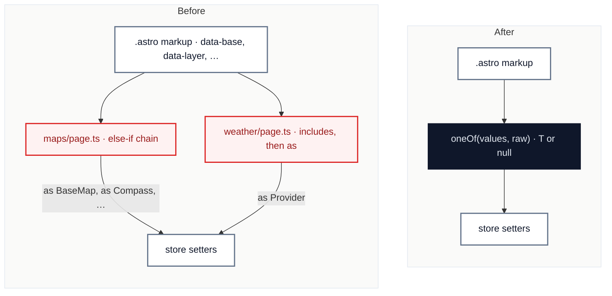

# C5 · Check data-* values before they reach the store

[← Report](README.md)

🟡 **Worth exploring** · `in-process` · ↔ `two-way` · builds on: none

`src/scripts/maps/page.ts:184,259-279` · `src/scripts/weather/page.ts:303-324` · `src/scripts/settings.ts:159`

Seven `as` casts turn markup strings into store unions with no check; `settings.ts:159` already guards stored values with a type-guard filter, so the pattern exists once and is copied nowhere.

**Removes:**

- `src/scripts/maps/page.ts:268-271`: `as MapCategory`, `as MeteoMode`, `as BaseMap`, `as Compass`.
- `src/scripts/maps/page.ts:275`: `layer as keyof Layers`.
- `src/scripts/weather/page.ts:315,320-321`: the ad hoc tab check and `pill as Provider`.

| Problem | Solution | Wins |
|---|---|---|
| A typo in a `data-*` attribute reaches a store setter as an invalid union member, because each page casts instead of checking. | One guard checks a raw attribute against the union's value list, and the pages pass only what it accepts. | casts go; typos are ignored and logged leverage: one guard, two pages |

Decisions

<!-- filled during implementation, one line each -->

