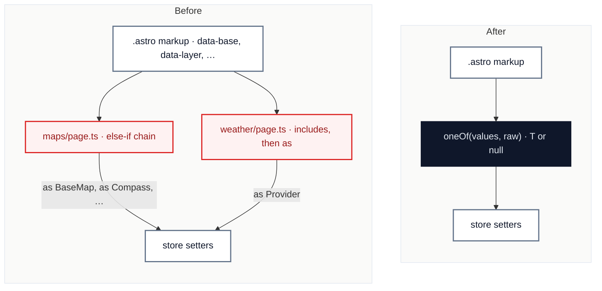

# C5 · Check data-* values before they reach the store

[← Report](README.md)

🟡 **Worth exploring** · `in-process` · ↔ `two-way` · builds on: none

`src/scripts/maps/page.ts:184,259-279` · `src/scripts/weather/page.ts:303-324` · `src/scripts/settings.ts:159`

Seven `as` casts turn markup strings into store unions with no check; `settings.ts:159` already guards stored values with a type-guard filter, so the pattern exists once and is copied nowhere.

**Removes:**

- `src/scripts/maps/page.ts:268-271`: `as MapCategory`, `as MeteoMode`, `as BaseMap`, `as Compass`.
- `src/scripts/maps/page.ts:275`: `layer as keyof Layers`.
- `src/scripts/weather/page.ts:315,320-321`: the ad hoc tab check and `pill as Provider`.

| Problem | Solution | Wins |
|---|---|---|
| A typo in a `data-*` attribute reaches a store setter as an invalid union member, because each page casts instead of checking. | One guard checks a raw attribute against the union's value list, and the pages pass only what it accepts. | casts go; typos are ignored and logged leverage: one guard, two pages |

Decisions

<!-- filled during implementation, one line each -->

- Q1: Does one guard delete complexity, or is this a drop? → Keep it, because `git grep` finds the same `allowed.includes(v as T) ? (v as T) : ...` check written nine times (`settings.ts` `oneOf` and :159, `app-state.ts` `isTab`, `safety/checklist.ts` `isCheckPoint`, `shell/header.ts` `isLang`, `forecast/query.ts` `readChoice`, `weather/query.ts` tab, `maps/basemap.ts` `baseMapKey`, `weather/page.ts` provider) and the six page casts skip it; one module replaces all of them.
- Q2: Interface shape: a type guard or a `T | null` picker? → A guard, `isOneOf<T extends string>(allowed: readonly T[], v: unknown): v is T`, because all nine sites either branch on the check or wrap it in their own fallback (`undefined`, `null`, `"topoColor"`), so a guard serves each with no adapter while a picker would force one of those fallbacks on all.
- Q3: Where does the guard live? → In `src/scripts/coerce.ts`, and `settings.ts` `oneOf` becomes `(v) => (isOneOf(allowed, v) ? v : undefined)` over it, because `coerce.ts` is the leaf module (no imports) whose header is "take a value of the expected type out of an untyped one" and already has 5 importers, while `settings.ts` is the storage module and `weather/stations.ts`, `safety/checklist.ts` and `forecast/query.ts` import nothing from it today; the canonical check moves rather than gaining a near-duplicate.
- Q4: `Layers` has no value list, so what does `data-layer` check against? → Add `LAYER_KEYS` in `settings.ts` and derive `type LayerKey` and `Layers = Record<LayerKey, boolean>` from it, because the interface is the only list today and the missing list forces `Object.keys(...) as (keyof Layers)[]` at `settings.ts:151`, `app-state.ts:164` and `maps/page.ts:172`; those casts go too.
- Q5: What happens to an unknown value? → The page ignores it and logs `console.error` with its module prefix (`[maps]`, `[weather]`, as the root checks at `maps/page.ts:365` and `weather/page.ts:358` use), because today `setMapCategory("typo")` writes the state and `localStorage` before `CATEGORY_LAYERS[category].includes` throws a TypeError (`app-state.ts:159-165`), and `weather/page.ts:303` turns a typo into "stations" silently.
- Q6: Does `AppState.toggleLayer` keep its own `hasOwnProperty` check? → No, because its only untyped caller is `maps/page.ts:256` (the other, `:137`, passes typed handoff keys) and no test covers the check; the guard now sits at the seam where the string enters, and the setter's `LayerKey` parameter states the rest.
- Q7: Which callers change? → `maps/page.ts` (click and change handlers, render loop), `weather/page.ts` (tab and provider), and the seven existing guards collapse onto `isOneOf` (`isTab`, `isCheckPoint`, `isLang` keep their names as one-liners, since `safety/page.ts` and the tests call them by name); `pressed` in `maps/controls.ts` compares strings and needs nothing, because it never narrows.
- Q8: Which tests survive? → All: `isTab`, `isCheckPoint`, `readChoice`, `readWeatherQuery`, `baseMapKey` and the settings parser tests keep exercising the same interfaces, and `coerce.test.ts` gains `isOneOf` cases (member, non-member, non-string), because the guard is in-process pure code (DEEPENING category: in-process) testable through its own interface.
- Q9: One-way door? → None: no wire or file format changes, because stored values already pass `PARSERS` on load and `data-*` attributes are build-time markup (7 in `src/components`), so the row stays two-way and not breaking.

