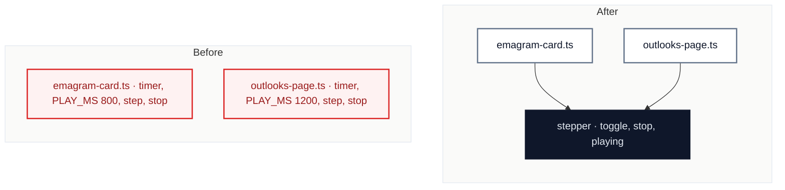

# C6 · One stepper for the forecast play buttons

[← Report](README.md)

🟡 **Worth exploring** · `in-process` · ↔ `two-way` · builds on: none

`src/scripts/forecast/emagram-card.ts:16,45,165-180` · `src/scripts/forecast/outlooks-page.ts:35,96,205-216`

Two copies of a play/step timer have drifted: one adds the playing class by hand and returns early, the other toggles and re-renders.

**Removes:**

- `src/scripts/forecast/emagram-card.ts:45,174`: its own `setInterval` handle and toggle.
- `src/scripts/forecast/outlooks-page.ts:96,212`: the same, with different playing-state handling.

| Problem | Solution | Wins |
|---|---|---|
| Each forecast view keeps its own interval, step and stop, so the play buttons behave differently and neither is tested. | One stepper module owns the interval and the playing state; each view gives it a length, a delay and what to do on a step. | locality: playback in one module one behaviour for both buttons |

Decisions

<!-- filled during implementation, one line each -->

