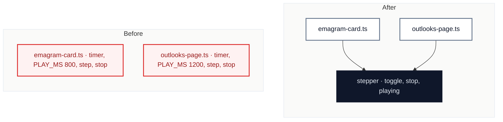

# C6 · One stepper for the forecast play buttons

[← Report](README.md)

🟡 **Worth exploring** · `in-process` · ↔ `two-way` · builds on: none

`src/scripts/forecast/emagram-card.ts:16,45,165-180` · `src/scripts/forecast/outlooks-page.ts:35,96,205-216`

Two copies of a play/step timer have drifted: one adds the playing class by hand and returns early, the other toggles and re-renders.

**Removes:**

- `src/scripts/forecast/emagram-card.ts:45,174`: its own `setInterval` handle and toggle.
- `src/scripts/forecast/outlooks-page.ts:96,212`: the same, with different playing-state handling.

| Problem | Solution | Wins |
|---|---|---|
| Each forecast view keeps its own interval, step and stop, so the play buttons behave differently and neither is tested. | One stepper module owns the interval and the playing state; each view gives it its button, a delay and what one step does. | locality: playback in one module one behaviour for both buttons |

Decisions

<!-- filled during implementation, one line each -->

- Q1: Is the vario timer in `safety/audio.ts:24,93` the same concept? → No, it stays out, because it repeats a beep at `varioTone(rate).cycleMs` and is re-armed on every `setRate` (audio.ts:38-41,88-93): a tone cadence, not a frame step. The webcam timelapse (`sheet/render.ts:81-94`) swaps an image source and has no timer. So the seam has exactly two adapters: grep finds `setInterval` only in emagram-card.ts:174, outlooks-page.ts:212 and audio.ts:93.
- Q2: Is the drift between the two play buttons intentional? → No, one behaviour for both, because both land in the same visible state: the `.playing` class only swaps the play and pause icons (`forecast-emagram.css:565-566`, plus the red fill at `forecast-outlooks.css:196`), and outlooks' `render()` after the toggle exists only to refresh that class (`outlooks-page.ts:173`). The stepper marks the button; outlooks drops the class line and the re-render on play.
- Q3: At the last frame, wrap or stop? → Wrap, as today, because both steps are `(i + delta + n) % n` (emagram-card.ts:102, outlooks-page.ts:184). Stepping stays in each view; the stepper only calls its tick.
- Q4: What sits behind the seam? → `stepper(button, delayMs, onTick)` in a new module, returning `{ toggle(): void; stop(): void; readonly playing: boolean }`; its implementation owns the interval handle, the playing state and the button's marking. Design-it-twice: a stepper that also owns the frame index and length was rejected, because emagram's position is fractional and eased through `requestAnimationFrame` (emagram-card.ts:85-103) and its slider writes any value, while outlooks keeps an integer index; owning the index would push both models into the interface.
- Q5: Is the playing state announced? → Yes, the stepper sets `aria-pressed` with the class, and both buttons start with `aria-pressed="false"` in their `.astro`, because neither sets it today (grep: no `aria-pressed` under `src/scripts/forecast/` or `src/components/forecast/`) while the webcam timelapse button already does (`sheet/webcam.ts:31`, `sheet/render.ts:87`). The only behaviour change, accessibility only.
- Q6: Dependency category and test seam? → In-process: timers and a class list, tested straight through the interface. Timers are not injected; `stepper.test.ts` uses `mock.timers.enable({ apis: ["setInterval"] })` and `tick`, because Node is v24.18.0 where `node:test` mock timers are stable. The button parameter is a narrow `PlayButton` type (`classList.toggle(token, force)` and `setAttribute`), which `HTMLElement` satisfies, so the test passes a plain object.
- Q7: Where does it live? → `src/scripts/forecast/stepper.ts` with `stepper.test.ts` beside it, because both callers are under `src/scripts/forecast/` and nothing else steps frames (Q1).
- Q8: Who stops it, and when? → The callers keep their stop sites, calling `stop()`, which is idempotent and unmarks the button: emagram on pick, on a sounding without steps, on a new station or sounding, and on `pagehide` (emagram-card.ts:133,143,194,203); outlooks on `pagehide` (outlooks-page.ts:222). Outlooks keeps playing across a type change, because that is today's behaviour and the refactor keeps it. Each view keeps its own delay (800 and 1200 ms) as the argument.
- Q9: Which tests survive, and which callers change? → All tests survive untouched, because no test imports `emagram-card.ts` or `outlooks-page.ts` (grep), so playback is untested today. The callers are those two files and the two `.astro` buttons. Deletion test: without the module, the interval, toggle, stop and marking (about ten lines) come back in both views, so it earns its keep, if modestly; not dropped. No new domain term, so the glossary is unchanged.

