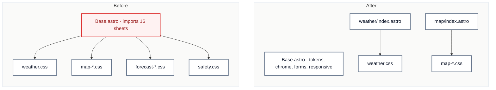

# C7 · Each tab imports its own stylesheets

[← Report](README.md)

⚪ **Speculative** · `in-process` · ↔ `two-way` · builds on: none

`src/layouts/Base.astro:9-26` · `src/pages/*/index.astro` · `src/styles/*.css`

`Base.astro` and `weather.css` change together in 3 of their 7 commits each (43%): a tab's style change lands in the layout every tab uses.

**Removes:**

- `src/layouts/Base.astro:15-26`: the tab-specific imports, and with them every page shipping every tab's rules.

| Problem | Solution | Wins |
|---|---|---|
| The shared layout imports every tab's stylesheet, so every page ships all of them and tab work touches the layout. | `Base.astro` keeps the shared sheets and each tab's page imports its own. | locality: tab styles beside the tab smaller CSS per page |

Speculative: the sheets are main.css cut at its banners "so every rule keeps its place in the cascade" (`Base.astro:10-11`), so a split must prove `responsive.css` still wins over the tab sheets.

Decisions

<!-- filled during implementation, one line each -->

- Q1: Where does Astro put CSS a page imports relative to CSS the layout imports? → by import position, because moving `weather.css` and `safety.css` into their pages and running `npm run build` linked `index.*.css`, then `leaflet.*.css`, then `Base.*.css` when the page imported them before `Base`, and `index.*.css` last when after; either way a moved sheet leaves its main.css place for one end of the cascade.
- Q2: Can the old order be pinned regardless of link order? → no, because `@layer` needs Safari 15.4 / Chrome 99 / Firefox 97 and `astro.config.mjs` targets Safari 14 / Chrome 87 / Firefox 78, which Lightning CSS does not lower `@layer` for.
- Q3: Is each tab sheet one tab's module? → no, because a class-name grep over `src/components`, `src/scripts`, `src/pages` finds `weather.css` styling forecast and safety (5 names each, e.g. `.forecast-section`, `.section-header-row`), `forms.css` used by safety, weather, forecast and the sheet, `meteo-extras.css` by map, weather, forecast and safety, and `forecast.css`'s only used names (`.metric-card` and kin) in the bottom sheet; the seam the card draws does not exist in the sheets.
- Q4: Which later sheets override a tab sheet on the same selector? → `meteo-extras.css` over `weather.css` (`.provider-filter-pills`) and over `forms.css` (`.modal-header`, `.modal-close`), `responsive.css` only over shared sheets (tokens, chrome, sheet), from a postcss pass over all 15 sheets; those keep their direction under a split, so Q1 and Q3, not these, are the risk.
- Q5: Is the win worth re-cutting the sheets? → no, because the whole layout bundle is 12.9 KB gzipped and the largest tab sheets are 1.0 to 2.2 KB gzipped each (lightningcss minify + gzip), so a page would save a few KB for a cascade reorder no test covers.
- Q6: Outcome → dropped, recorded in `docs/adr/0001-stylesheets-load-from-the-layout.md`. Side fact for a later look: `leaflet.css` (6.4 KB gzipped, used by map and forecast outlooks/emagram only) already links first, so moving it to those pages would keep its order.

