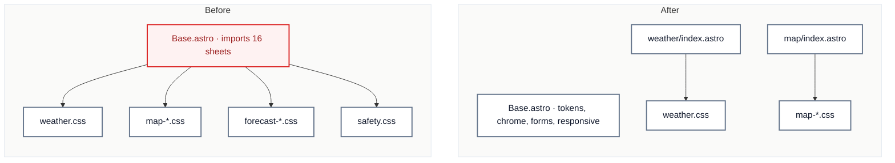

# C7 · Each tab imports its own stylesheets

[← Report](README.md)

⚪ **Speculative** · `in-process` · ↔ `two-way` · builds on: none

`src/layouts/Base.astro:9-26` · `src/pages/*/index.astro` · `src/styles/*.css`

`Base.astro` and `weather.css` change together in 3 commits (60%): a tab's style change lands in the layout every tab uses.

**Removes:**

- `src/layouts/Base.astro:15-26`: the tab-specific imports, and with them every page shipping every tab's rules.

| Problem | Solution | Wins |
|---|---|---|
| The shared layout imports every tab's stylesheet, so every page ships all of them and tab work touches the layout. | `Base.astro` keeps the shared sheets and each tab's page imports its own. | locality: tab styles beside the tab smaller CSS per page |

Speculative: the sheets are main.css cut at its banners "so every rule keeps its place in the cascade" (`Base.astro:10-11`), so a split must prove `responsive.css` still wins over the tab sheets.

Decisions

<!-- filled during implementation, one line each -->

