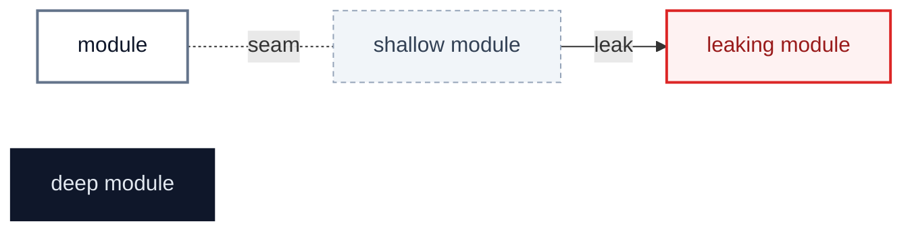
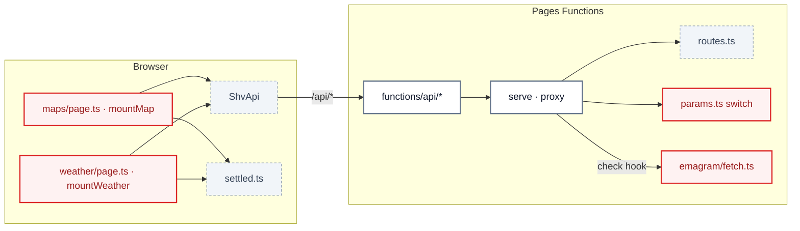

# shv-meteo-web: route rules are split from their routes, and the map page's orchestration has no module

`2026-11-25` · at `e11aa63` (`main`) · scope: the churn hot spots of the last six months (`maps/page.ts` 15 commits, `weather/page.ts` 11, `upstream/respond.ts` 10, `emagram/fetch.ts` 9, `upstream/routes.ts` 8, `api.ts` 7) and the co-change pairs around them · glossary: `GLOSSARY.md` · ADRs read: none (no `docs/adr/`)

**Jump to:** [Status](#status) · [Where it hurts](#where-it-hurts) · [Smaller findings](#smaller-findings) · [Recommendation](#recommendation) · cards: [C1](C1-route-owns-its-parameters.md) · [C2](C2-one-failure-mode-for-shvapi.md) · [C3](C3-map-session-module.md) · [C4](C4-weather-view-state.md) · [C5](C5-checked-data-dispatch.md) · [C6](C6-forecast-stepper.md) · [C7](C7-per-tab-stylesheets.md)

Legend

## Status

The backlog, in rank order. After the scan only three parts of the report change: this table (with the **Smaller findings** entry for each `S` row a Build phase adds), each card's **Decisions**, and **Departures**. The findings stay as found.

| ID | Candidate | Strength | Door | Lens | Status | Branch | PR | Breaking | Notes |
|---|---|---|---|---|---|---|---|---|---|
| [C1](C1-route-owns-its-parameters.md) | Each route owns its parameter rules | 🟢 Strong | ↔ two-way | coupling | pr-open | `refactor/route-owns-its-parameters` | #66 | no | |
| [C2](C2-one-failure-mode-for-shvapi.md) | One failure mode and typed answers for `ShvApi` | 🟢 Strong | ↔ two-way | maintainability | pr-open | `refactor/one-failure-mode-for-shvapi` | #67 | no | |
| [C3](C3-map-session-module.md) | Move the map page's loading, handoff and redraw into one module | 🟢 Strong | ↔ two-way | deepening | pr-open | `refactor/map-session-module` | #68 | no | builds on C2 |
| [C4](C4-weather-view-state.md) | Let the pair state own retry and what was drawn | 🟡 Worth exploring | ↔ two-way | deepening | pr-open | `refactor/weather-view-state` | #69 | no | |
| [C5](C5-checked-data-dispatch.md) | Check `data-*` values before they reach the store | 🟡 Worth exploring | ↔ two-way | maintainability | pr-open | `refactor/checked-data-dispatch` | [#70](https://github.com/simonsteiner/shv-meteo-web/pull/70) | no | |
| [C6](C6-forecast-stepper.md) | One stepper for the forecast play buttons | 🟡 Worth exploring | ↔ two-way | maintainability | in-progress | `refactor/forecast-stepper` | | | |
| [C7](C7-per-tab-stylesheets.md) | Each tab imports its own stylesheets | ⚪ Speculative | ↔ two-way | coupling | in-progress | `refactor/per-tab-stylesheets` | | | cascade order risk |
| [S1](#s1--one-station-id-pattern) | One station id pattern | - | ↔ two-way | coupling | pr-open | rides with C1 | #66 | no | |
| [S2](#s2--hand-the-compute-its-timeout) | Hand the compute its timeout | - | ↔ two-way | coupling | pr-open | rides with C1 | #66 | no | |
| [S3](#s3--one-default-pair-and-one-retryable-memo-in-shvapi) | One default pair and one retryable memo in `ShvApi` | - | ↔ two-way | maintainability | pr-open | rides with C2 | #67 | no | |
| [S4](#s4--fail-loudly-on-a-changed-sounding-shape) | Fail loudly on a changed sounding shape | - | ↔ two-way | maintainability | in-progress | `chore/arch-review-small-fixes` | | | |
| [S5](#s5--use-round1-from-unitsts) | Use `round1` from `units.ts` | - | ↔ two-way | maintainability | in-progress | `chore/arch-review-small-fixes` | | | |
| [S6](#s6--drop-exports-nothing-imports) | Drop exports nothing imports | - | ↔ two-way | coupling | in-progress | `chore/arch-review-small-fixes` | | | |
| [S7](#s7--replace-the-200-ms-resize-timer) | Replace the 200 ms resize timer | - | ↔ two-way | maintainability | in-progress | `chore/arch-review-small-fixes` | | | |

Strength: 🟢 Strong · 🟡 Worth exploring · ⚪ Speculative · 🔴 live defect (a bug reproduced during the scan).
Door: ↔ two-way (a revert undoes it) · 🚪 one-way (a data migration, a published wire or file format, deleted user data; stops at Step 6 for the user).
Lens: `deepening` · `maintainability` · `coupling`.
Status: `todo` · `in-progress` · `pr-open` · `merged` · `blocked` · `dropped`. `blocked` and `dropped` always carry a reason in Notes.

## Where it hurts

The six most-changed code files are marked: 60 file changes in six months between them; `respond.ts` and `routes.ts` change together in 6 commits (75%), and both page scripts are untested closures of over 300 lines.

## Smaller findings

### S1 · One station id pattern

`src/scripts/upstream/params.ts:9` · `src/scripts/handoff.ts:20` · rides with C1

The Function accepts `/^[a-z_]+:[^/\s]{1,100}$/` and the handoff accepts `/^[\w-]{1,50}:[^\s/]{1,100}$/`, so an id with a digit or hyphen in its provider passes the browser and gets a 400. Export one `STATION_ID` and import it in both.

### S2 · Hand the compute its timeout

`src/scripts/foehn/fetch.ts:34` · `src/scripts/emagram/fetch.ts:28` · rides with C1

Both compute modules copy `ROUTES.<name>.timeoutMs` into a module constant, so they import the route table only to read back their own entry. `serve` hands the compute the route's timeout, and the route-count comments in `routes.ts:107-114` move beside the code they describe.

### S3 · One default pair and one retryable memo in ShvApi

`src/scripts/api.ts:228` · `src/scripts/api.ts:196-246` · rides with C2

`getFoehn` writes `"KLO_LUG"` where `DEFAULT_PAIR` (`foehn/pairs.ts:84`) exists, and `getMeasurements` and `getFoehn` each reimplement "keep the promise, forget it on null". Import `DEFAULT_PAIR` and give both one private memo helper.

### S4 · Fail loudly on a changed sounding shape

`src/scripts/emagram/levels.ts:12-23` · `src/scripts/emagram/gridpoint.ts:42` · `src/scripts/emagram/fetch.ts:109-124` · own PR

The ICON parsers cast `raw as {…}` and fall back to `[]`, so a changed upstream shape becomes an empty sounding instead of an error, and `soundingRoute` looks the grid point up twice with an `as GridPoint` between. Parse through `coerce.ts` and throw on a missing array, and let the check hand its grid point on.

### S5 · Use round1 from units.ts

`src/scripts/app-state.ts:253` · `src/scripts/forecast/emagram.ts:128` · own PR

Two copies of `Math.round(v * 10) / 10` sit beside `round1` (`units.ts:19`), one named `r1`. Import `round1`.

### S6 · Drop exports nothing imports

`src/scripts/emagram/fetch.ts` (`soundingUrl`, `fetchForecast`) · `src/scripts/foehn/report.ts` (`PairStatus`) · `src/scripts/settings.ts` (`THEMES`, `CHECKLIST_KEY`) · `src/scripts/obstacles/shards.ts` (`MAX_SHARD_BYTES`) · `src/scripts/forecast/emagram.ts` (`PAD_R`) · own PR

Each is referenced only in its own file, and `mountMap` and `mountWeather` are exported though their page script mounts itself. Drop the `export` keyword (keep any a test imports).

### S7 · Replace the 200 ms resize timer

`src/scripts/maps/view.ts:58-59` · own PR

`invalidateSize` runs on the next frame and again after a guessed 200 ms, in case the container's size arrives late. A `ResizeObserver` on the container calls it whenever the size changes, timer gone.

## Recommendation

> [!IMPORTANT]
> **Start with [C1 · Each route owns its parameter rules](C1-route-owns-its-parameters.md)**: the upstream modules are the most-changed code together, and every new route today touches a string-keyed switch that compiles without its branch.
>
> **Proposed batch** (every 🟢 Strong, in order): C1 → C2 → C3

## Departures

<!-- filled during implementation: where a PR deliberately differs from this report, and why -->

- **C2, Q5:** the obstacle index read goes through `getJson` inside `retryable`, so a failed index read now logs under `[ShvApi.getObstacles]` as an HTTP or network error like every other read, not as "Failed to load obstacles". The answer (null) and the retry on the next call are as decided.
