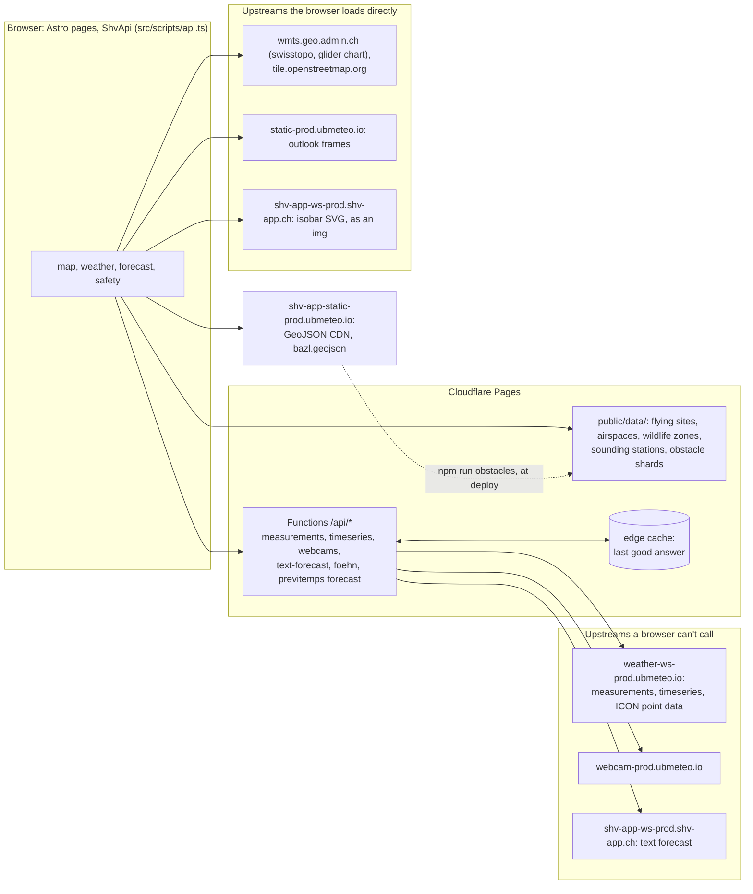

# Architecture

How this web app gets, processes and shows its data. Static Astro pages with TypeScript page scripts on Cloudflare Pages, and Pages Functions for the upstream calls a browser can't make. The diagram below is our runtime; the official native app's hosts, and which of them we use, are in [reference/shv-native-app.md](reference/shv-native-app.md), and its login and member data in [reference/shv-native-auth.md](reference/shv-native-auth.md).

Each upstream in the diagram has a row in [data-queries.md](architecture/data-queries.md), with the reason for its path.

- [architecture/data-queries.md](architecture/data-queries.md): every upstream, which calls go straight from the browser and which through a Function in `functions/api/`, the rules every Function keeps, and the edge-cache, CPU and vector-tile spikes. Read it before adding or changing an endpoint.
- [architecture/data-pipeline.md](architecture/data-pipeline.md): what the data holds and how the app reads it: the GIS datasets, flying sites, station pairs, measurement units, map controls, forecasts, soundings and BAZL obstacles.
- [architecture/web.md](architecture/web.md): pages, the shell, state, the tab pages, the CSP, the data client, translations, the API and the dev launcher.

The rule against mock, sample or synthesized data, and the one against accepting SHV passwords, are hard constraints in [AGENTS.md](../AGENTS.md).
